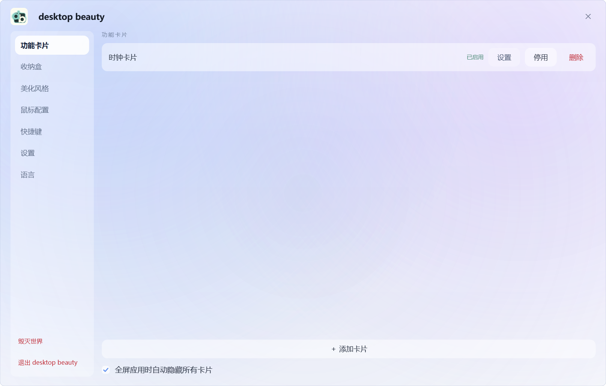
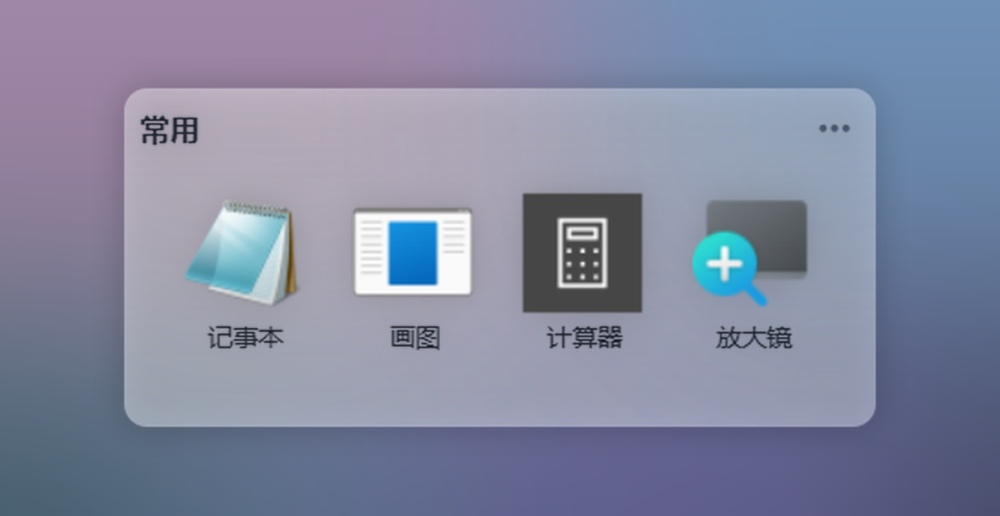
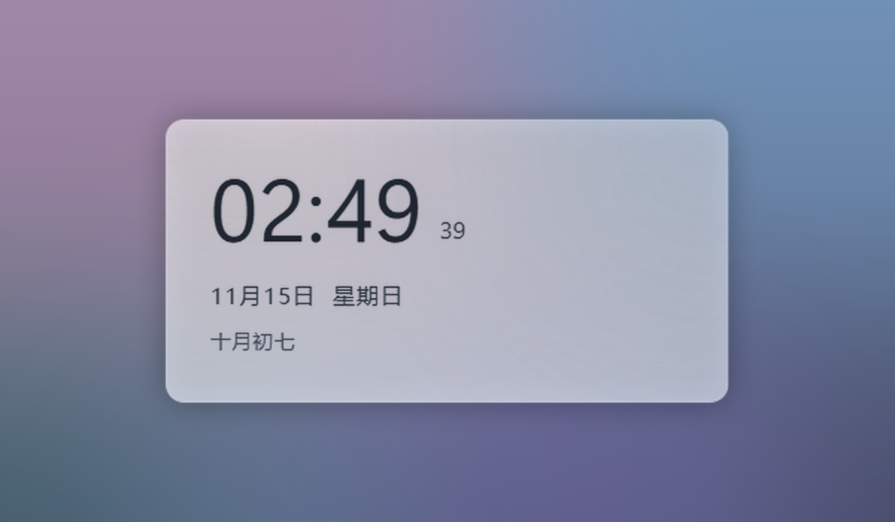

# desktop beauty · 毛玻璃收纳盒

一个 Python + PySide6 的 Windows 11 桌面小工具：把桌面上的两个图标拖到一起，就生成一个**毛玻璃收纳盒**（图标从桌面收进去）；再配一组可自由摆放的**毛玻璃卡片**——时钟 / 待办 / 日历 / 倒计时 / 正在播放的音乐。界面全部自绘，不用任何原生控件。

> A glass-morphism desktop for **Windows 11**, built with Python + PySide6. Drag two desktop icons together and they turn into a frosted-glass box; floating glass cards show a clock, to-do list, calendar, countdown and the music that's playing. Everything is hand-drawn — no native-looking widgets.



| 收纳盒（展开） | 时钟卡片 |
| --- | --- |
|  |  |

## 快速开始

| 方式 | 适合 | 做法 |
| --- | --- | --- |
| **免安装 exe** | 只想用 | 下 Release 里的 `desktop-beauty-1.0.1-win64.zip` → 解压 → 双击 `desktopbeauty.exe` → 点「安装到这台电脑」 |
| **源码运行** | 想改代码 | Python 3.12 + `pip install -r requirements.txt` → 双击 `启动.cmd`（等价于 `pythonw run.pyw`） |
| **自己打包** | 想分发 | 见下面「给别人用：打包 + 一键安装」 |

装好之后：`Ctrl+Space` 开关面板、`Shift+Space` 开关美化、桌面图标拖到一起就建盒。**任务栏那颗图标要自己右键固定一次**——Windows 11 只准人点，原因见「任务栏上的入口」。

只支持 **Windows 11**（24H2 上实测）。Win10 的任务栏、圆角、毛玻璃行为都不一样，没测过。

## 它改了系统里的什么

这类桌面美化工具最容易让人警惕，所以列清楚。**全部只写当前用户（HKCU），不碰 HKLM，不需要管理员**：

| 动作 | 位置 / 机制 | 什么时候 |
| --- | --- | --- |
| 判断「是不是在拖桌面图标」 | 全局鼠标钩子 `WH_MOUSE_LL`（只装鼠标，**从不装键盘钩子**） | 常驻 |
| 两个全局快捷键 | `RegisterHotKey`：`Ctrl+Space` / `Shift+Space` | 常驻 |
| 把盒子压住的桌面图标挪开 | 给桌面 ListView 发消息（`LVM_SETITEMPOSITION`） | 移动 / 新建盒子时 |
| 把「此电脑 / 回收站 / 控制面板 / 网络」收进盒子 | `HKCU\Software\Microsoft\Windows\CurrentVersion\Explorer\Advanced\<CLSID>` = 0 / 1 | 收进盒子时隐藏，销毁盒子时还原 |
| 卸载项 | `HKCU\Software\Microsoft\Windows\CurrentVersion\Uninstall\desktopbeauty` | 安装时写，卸载时删 |
| 桌面上的指针 | 把系统箭头临时换成透明、自己画圆点（退出时恢复） | 开着「圆点指针」时 |
| 任务栏黑边 | 托管 **TranslucentTB**（它自己注入 explorer，本程序只管启停和配置） | 只在你装过 TranslucentTB 时 |
| 出网请求 | 天气 `open-meteo.com`、定位 `ip-api.com` / `ipwho.is`、封面 `music.163.com` | 天气 / 音乐卡片 |

不做的：不改壁纸、不改任务栏对齐和搜索框（那些是手动设置，本文档只写了怎么改）、不注入 explorer、不装键盘钩子。联网只有两处：天气每 5 分钟查一次（有缓存）、音乐卡片偶尔去网易云搜封面；没有开机常连的后台服务。

## 数据存在哪

全部在 `%APPDATA%\DeskBeauty\`：

| 路径 | 内容 |
| --- | --- |
| `config.json` | 卡片、热键、玻璃浓度、圆角、语言、鼠标样式… |
| `boxes\<id>\` | 每个收纳盒收进去的**图标文件本体**（不是快捷方式）——所以卸载前必须先「毁灭世界」，否则桌面会空掉 |
| `agenda.json` / `weather.json` | 待办与纪念日、天气缓存 |
| `icons\` | 桌面图标缩略图缓存 |
| `app.log` / `error.log` / `crash.log` | 运行日志（`pythonw` 没有控制台，出事只能看这个） |

删掉这个目录 = 恢复成第一次启动的样子（先「毁灭世界」把图标放回桌面）。

## 任务栏上的入口

入口只有一个：**任务栏上第 2、3 个图标之间**那颗 desktop beauty。

现状（还在搭）：那颗必须是**系统固定项**。原因很简单——任务栏图标之间只有 ~15px 空隙（图标 30px、间距 45px），自己画一个窗口上去必然压住两边，用户要的是「让出位置」，那就只能让系统把后面的图标挤过去；而 win11 只允许**人**去固定和拖动排序。

已经验证过的死路：

- 自绘浮窗（试过）：能精确卡在缝里，但会盖住两侧各 ~12px，且不是真按钮 → 已撤掉
- 程序自动固定：`Shell.Application` 的动词列表里**没有** `PinToTaskbar`（win11 把它移进新式菜单了），`Start-Process -Verb PinToTaskbar` 直接报「没有关联的应用」→ 固定这一步只能人点一次
- 官方那条路（`TaskbarManager`）同样堵死：26100 上 `GetDefault()` 直接抛 **"Access is denied. Feature com.microsoft.windows.taskbar.pin is not available."**——这是「受限功能」，要微软批准才能调。实测这台机器的 `shell:AppsFolder` 里，**没钉的**应用动词只有「打开 / 打开文件位置 / 打开新窗口 / 以管理员身份运行 / 卸载 / 创建快捷方式」，**钉住的**才有「从任务栏取消固定」，也就是说钉的那一半被挪进 `twinui.pcshell` 的新式 UI 里了，Win32 侧没有入口（`shell32!SHPinToTaskbar` / `SHUnpinFromTaskbar` / `TogglePin` 全都不存在）

已经铺好的地基：

| 东西 | 在哪 | 说明 |
| --- | --- | --- |
| 单击转发 | `bin/launcher.cs` → `%LOCALAPPDATA%\Programs\desktopbeauty\desktopbeauty.exe` | 编译成 winexe，只 `OpenEvent` + `SetEvent`，实测端到端 **120ms**；**常驻进程不在时直接把 app 拉起来**（早期版本会静静 `return 1`，表现就是「点图标没反应」） |
| 信号通道 | `beauty/signal.py` | 三个命名事件 `Local\desktopbeauty.{toggle,panel,quit}`，常驻进程轮询，快捷方式 `SetEvent` 一下就行 |
| 开始菜单 | `desktop beauty`（`shell:startup` 之外那层 Programs） | 指向 `pythonw run.pyw --toggle`，右键它就能「固定到任务栏」 |
| 开机自启 | 启动文件夹 `desktop beauty.lnk` | 保证常驻进程在跑，事件才有接收方 |
| 运行日志 | `%APPDATA%\DeskBeauty\app.log` / `crash.log` | 启动、信号、正常退出都记一行；`faulthandler` 抓段错误。`pythonw` 没有控制台，出事只能看这个 |
| 面板 | 任务栏图标 Shift+单击 / 开始菜单「desktop beauty 面板」 | 一块自绘毛玻璃，全部功能：卡片列表与参数、收纳盒列表（定位 / 改名 / 删除 / 撤销上次建盒）、玻璃浓度 / 圆角、美化风格、鼠标、快捷键、语言、毁灭世界、退出 |

## 给别人用：打包 + 一键安装

对方机器上不会有 Python 3.12、PySide6，也没有这个项目的路径，所以给出去的是**打包版**：一个文件夹，里面是 `desktop beauty.exe`（转发器）+ `app\`（PyInstaller 打出来的本体，约 128 MB）。


**打包**（构建环境单独放在 `D:\tmp\buildenv`，不污染系统 Python）：

```
D:\python\python3.12.4\python.exe -m venv D:\tmp\buildenv --system-site-packages
D:\tmp\buildenv\Scripts\python.exe -m pip install pyinstaller
D:\tmp\buildenv\Scripts\python.exe -m PyInstaller --noconfirm --clean --windowed ^
  --name desktopbeauty-app --icon assets\app.ico --paths . ^
  --hidden-import beauty.install --hidden-import beauty.setup_window ^
  --add-data "assets;assets" --distpath <产物目录> --workpath <临时> --specpath <临时> run.pyw
```

`--add-data "assets;assets"` 是必须的：`assets/logo.png`（面板标题徽标）和 `app.ico` 走的是 `Path(__file__).parent.parent / "assets"`，冻结之后 `_MEIPASS` 就是 `app\_internal`，所以数据要落在 `_internal\assets`。

打好的包在 `dist\desktop-beauty-1.0.1-win64.zip`（49.3 MB / 解压 128 MB，SHA256 `33A24078…606D5C`）：解压出一个 `desktop beauty\` 文件夹，里面 `desktopbeauty.exe` + `app\`，双击 exe 就会弹出下面那块玻璃窗，点一下按钮装好。

### 覆盖安装（升级到新版本）

已经装过旧版的人，把新包解压到**任意目录**（不要解压到 `%LOCALAPPDATA%\Programs\desktopbeauty` 里）→ 双击 `desktopbeauty.exe` → 玻璃窗上写「覆盖安装」→ 点一下，旧版本自动退出、文件被覆盖，然后新版自己起来。整个换文件过程实测 **2.5 秒**。

三处配合才成立，少一个都升不了级：

1. **转发器**（`bin/launcher.cs` → `WantsUpgrade()`）：没有参数被双击、而且 `%LOCALAPPDATA%\Programs\desktopbeauty\desktopbeauty.exe` 存在、又**不是自己这个目录** → 判定为「拿新版在旧机器上装」，于是用 `--setup` 拉起本包里的本体。以前这里只会发一个 `toggle` 信号，用户看到的就是「双击没反应」。
2. **`--setup` 模式**（`beauty/app.py` 的 `_run_setup_only`）：只弹安装窗，**不抢 `%TEMP%\deskbeauty.lock`**、不建 Controller（盒子/卡片/快捷键/鼠标钩子都不碰）。抢锁的话旧版本正跑着，新进程会一刀切退出。
3. **`install.stop_installed()`**：覆盖前先把「这份安装」的常驻实例停掉（发 `quit` 事件 + 轮询 pid 是否消失，最多 20 秒），否则 `app\desktopbeauty-app.exe` 和 `app\_internal\*.dll` 全被占着，`copytree` 直接 `WinError 32`。只认自己这份安装的进程——源码版或者别处的副本不动。

用户数据（`%APPDATA%\DeskBeauty`：桌面收纳盒、卡片、主题、快捷键）不在安装目录里，升级不会碰它；卸载项里的 `DisplayVersion` 会跟着更新。

**也可以让 GitHub 打**：`.github/workflows/release.yml` 在推 `v*` 标签或手动 dispatch 时，用 `windows-latest` 跑同一套 PyInstaller 命令、组装目录、打 zip，标签的话顺带挂到 Release 上（里面带 SHA256）。签名还没接，见 [docs/code-signing.md](docs/code-signing.md)。


### 对方电脑弹「智能应用控制已阻止可能不安全的应用」

这个 exe 没有代码签名，对方机器要是开着 Smart App Control（智能应用控制），双击就被拦，提示「已阻止 D:\...\desktopbeauty.exe，因为无法验证其发布者」。包本身没坏。

SAC 的判断顺序是：先问云端这条 exe 安不安全 → 云端答不上来就查数字签名 → 没签名 / 签名无效一律当「不受信任」拦掉。它**没有白名单、没有「仍要运行」、也没有按单个应用放行的入口**（[Microsoft 官方 FAQ](https://support.microsoft.com/zh-cn/windows/security/threat-malware-protection/smart-app-control-frequently-asked-questions)：目前无法绕过针对单个应用的智能应用控制保护）。所以「右键 → 属性 → 解除锁定」清掉下载标记也没用——拦的依据是签名，不是 MOTW。

两条路：

1. **让对方关掉 SAC**（现在就能用）：设置 → 隐私和安全性 → Windows 安全中心 → 应用和浏览器控制 → 智能应用控制 → 关。较新的 Windows 更新支持之后重新打开（老版本关掉就只能重置系统才能开回来），关之前跟对方讲清楚。
2. **给 exe 签名**（长期正路）：SAC 见到有效签名就放行（不需要攒信誉，这点和 SmartScreen 不同）。开源项目可以申请 [SignPath Foundation](https://signpath.org/) 的免费签名（要求 OSI 许可证、公开仓库、签名构建必须出自 CI、每个版本人工批准）；付费的话 Azure Artifact Signing（原 Trusted Signing）约 $10/月，个人也能过身份验证。签完 `desktopbeauty.exe` 和 `app\` 里的本体都得签。

看对方机器开没开（`0` 关 / `1` 开 / `2` 评估模式，评估模式不拦）：

```powershell
Get-ItemProperty 'HKLM:\SYSTEM\CurrentControlSet\Control\CI\Policy' VerifiedAndReputablePolicyState
```

**安装**（`beauty/install.py`）做五件事，对方看到的只有一个玻璃窗：

1. 把 `app\` + 转发器复制到 `%LOCALAPPDATA%\Programs\desktopbeauty\`
2. 开始菜单：`desktop beauty`（toggle）、`desktop beauty 面板`（panel）
3. 开机自启：Startup 里的 `desktop beauty.lnk`，直接指向本体（不经转发器，省一次跳转）
4. 桌面快捷方式
5. `HKCU\...\Uninstall\desktopbeauty` 卸载项（「应用和功能」里能看到，卸载走 `desktopbeauty-app.exe --uninstall`）

装完自己换进程：`relaunch_installed()` 用一条隐藏的 `cmd /c ping … & start` 等旧进程放开 `%TEMP%\deskbeauty.lock` 再起安装目录那一份。

**第一次双击**（`beauty/setup_window.py`）：只有「打包版 + 不是从安装目录跑起来」才弹，`--install` 也能手动叫出来。点「直接用」= **不装进系统**：

- 文件就留在你解压出来的那个文件夹，不建开始菜单 / 开机自启 / 桌面快捷方式 / 卸载项，下次开机也不会自己起来，想用就再双击那个 exe
- 功能一样不少（卡片、盒子、`Ctrl+Space` 面板、`Shift+Space` 开关），配置照样写 `%APPDATA%\DeskBeauty`——和装过的那一份共用同一套数据
- 点过之后**这个文件夹**不再问（记号 `%APPDATA%\DeskBeauty\portable_dismissed` 里存的是发行目录路径，换个文件夹重新解压会再问一次）；想装回去就删掉这个文件，或者直接跑 `desktopbeauty-app.exe --install`

源码跑（`pythonw run.pyw`）永远不弹——开发机上的快捷方式不会被顶掉。判断依据是 `install.dev_install_present()`：`target.txt` 第一行是 `pythonw.exe` 就当作开发机安装，安装器不覆盖（要强装得 `install(force=True)`）。

**任务栏那颗图标**：装完第一次运行会浮一条提示「右键开始菜单里的 desktop beauty → 固定到任务栏」。为什么不自动钉见上面「已经验证过的死路」——Windows 11 只准人点，`TaskbarManager` 是受限功能。没钉也不影响用：`Ctrl+Space` 开面板、`Shift+Space` 开关美化，开始菜单里也有两个入口。

**卸载**：三个入口，做的事完全一样：

- 面板 → 设置页**最下面**那个红字「卸载 desktop beauty」（`settings.py` 的 `_uninstall()` → `ctrl.uninstall_app()`，先确认再动手）
- 应用和功能里点卸载（`UninstallString` 就是 `desktopbeauty-app.exe --uninstall`）
- 命令行 `desktopbeauty-app.exe --uninstall`

顺序是**先毁灭世界、再删文件**：

1. 图标全部放回桌面（等价于面板里那个按钮，走同一个 `destroy_world()`：每个盒子 `remove_to` 把文件挪回桌面、位置摆在盒子附近），卡片清空、配置落盘
2. 常驻进程在跑 → 发 `Local\desktopbeauty.reset` 事件，等它自己退出（等的是**进程还在不在**，不是 `quit` 事件：命名事件整个登录会话共享，别的实例活着会让它白等到超时）
3. 进程没在跑、但 `%APPDATA%\DeskBeauty\boxes` 还有盒子 → 拉起一份 `desktopbeauty-app.exe --reset-quit` 做完再退
4. 删快捷方式 + 卸载项，程序目录延迟到进程退出后 `rmdir`

只有「这份安装」的实例会被通知：`_is_our_instance()` 拿 `%TEMP%\deskbeauty.lock` 里的 pid 查进程镜像路径，和 `installed\app\desktopbeauty-app.exe` 对不上就不动（否则在开发机上点卸载，源码版那个实例的桌面会被清空）。`%APPDATA%\DeskBeauty` 本身保留（盒子目录这时已经空了），重装还能接着用主题/快捷键。

面板里那个按钮走的是 `uninstall(wipe=False)`：因为**它自己就是那个常驻实例**，`destroy_world()` 当场做掉，不能再发 `reset` 事件（那会变成自己等自己退出）。

**源码版也会被这个按钮卸掉**：它删的是「这套安装」——开始菜单两项、启动项、`%LOCALAPPDATA%\Programs\desktopbeauty` 里的转发器，项目目录本身不动。想还原（或者手动搭一遍），用这段：

```powershell
$dst = "$env:LOCALAPPDATA\Programs\desktopbeauty"
$proj = "C:\path\to\desktop-beauty"                # 换成项目目录
$pyw  = "C:\path\to\python\pythonw.exe"            # 换成你的 pythonw
New-Item -ItemType Directory -Force $dst | Out-Null
Copy-Item "$proj\bin\desktopbeauty.exe" $dst -Force
Set-Content "$dst\target.txt" "$pyw`n$proj`n" -Encoding utf8 -NoNewline
$sh = New-Object -ComObject WScript.Shell
foreach ($it in @(@("desktop beauty", "toggle"), @("desktop beauty 面板", "panel"))) {
    $s = $sh.CreateShortcut("$env:APPDATA\Microsoft\Windows\Start Menu\Programs\$($it[0]).lnk")
    $s.TargetPath = "$dst\desktopbeauty.exe"; $s.Arguments = $it[1]
    $s.WorkingDirectory = $dst; $s.IconLocation = "$dst\desktopbeauty.exe,0"; $s.Save()
}
$s = $sh.CreateShortcut("$env:APPDATA\Microsoft\Windows\Start Menu\Programs\Startup\desktop beauty.lnk")
$s.TargetPath = $pyw; $s.Arguments = "run.pyw"; $s.WorkingDirectory = $proj
$s.IconLocation = "$env:APPDATA\DeskBeauty\icons\app.ico,0"; $s.Save()
```

还剩一件只能人做的事：如果图标钉过任务栏，卸载后那颗按钮还在（指向已删掉的转发器）。Windows 不让程序取消钉住，只能右键那颗图标 → 从任务栏取消固定。

**转发器的两种目标**（`bin/launcher.cs`，改完用 `csc /target:winexe /win32icon:assets\app.ico` 重编）：

| `target.txt` | 行为 |
| --- | --- |
| 第一行 `pythonw.exe`、第二行项目目录 | 源码版：跑 `<目录>\run.pyw`（老安装就是这个） |
| 第一行 `app\desktopbeauty-app.exe`、第二行工作目录 | 打包版：直接启动本体（相对路径按 exe 所在目录解析） |

## 设置面板（`beauty/settings.py`）

以前是个浅色 `QDialog`，跟桌面风格完全不搭。现在是一块 `GlassWindow`：无边框、圆角、**白色毛玻璃**（和收纳盒同一种玻璃），拖背景就能整个挪走，Esc 关掉。


玻璃这块和盒子不一样：

- 盒子是**纯自绘**（半透明渐变 + 柔光），因为它要频繁拖动，系统亚克力每移动一像素都要重算，会掉帧
- 面板**开了系统亚克力**（`real_blur = True`），因为面板上全是小字，纯半透明会把背后窗口的文字透上来搅糊；再配 `DwmSetWindowAttribute(DWMWA_WINDOW_CORNER_PREFERENCE, ROUND)` 让合成层按圆角裁，所以不会出现当年那种「四个黑角」
- 亚克力那层模糊的 tint 是**深蓝黑写死的**，白玻璃必须换成冷白（`apply_acrylic(..., rgb=...)`），否则白面板背后会压出一层脏灰
- 面板里的「收纳盒 → 玻璃浓度 / 圆角」是**全局参数**（`config.box_glass_alpha` / `box_radius`），改完当场作用到所有盒子和拖拽预览上

钉住之后要做的事：右键 = 系统的跳转列表（原生毛玻璃），里面用 `ICustomDestinationList` 注册「打开面板 / 启用桌面美化 / 退出」。

### 跳转列表这条路（已实测，暂时堵着）

`beauty/jumplist.py` 写了完整实现（`IShellLink` 建任务 → `IEnumerableObjectCollection` 组成 `IObjectArray` → `ICustomDestinationList` 注册），但在这台机器上 `AddUserTasks` 一直返回 `0x80040F03`：换成记事本快捷方式、去掉 AppID、改成内存里的 `IShellLink` 对象（那样是 `0x80070057`）都一样，说明不是 item 的问题，是这台机器/这个版本不放行。

顺带记一个坑：`BeginList` 的参数顺序是 **`(UINT *pcMinSlots, REFIID riid, void **ppv)`**，pcMinSlots 在最前面（MSDN 的 C++ 语法块和 SWT 的绑定都是这个顺序）。按 C++ 头的直觉写成 `(riid, ppv, slots)` 会一直 `E_NOINTERFACE`。

替代方案（在用）：给 `HKCU\Software\Classes\Applications\pythonw.exe\shell\打开面板` 注册一个 shell 动词，右键那个快捷方式时它会作为一项出现。

## 收纳盒怎么用

**能收的是什么**：桌面上任意**普通文件**（快捷方式、`.url`、文档、图片、压缩包、exe）**和文件夹**。收进去就是真的 `shutil.move` 到 `%APPDATA%\DeskBeauty\boxes\<盒子id>\`（同一个卷上等于一次改名，跟文件多大没关系），`origins` 里记着原来的目录，拖回桌面 / 解散 / 毁灭世界 / 卸载都会放回原位；文件夹是整棵子树一起搬，回来时内容一个不少。

文件夹的规则（被拒时会浮一条提示，不再静默吞掉）：

| 规则 | 细节 |
| --- | --- |
| 文件夹**只收桌面上的** | 桌面目录本身或它下面的子目录；盒子之间互相搬不受限。从资源管理器随便拖 `C:/Windows/...`、`C:/Users/.../Documents` 进来会拒 |
| **别的卷只收 ≤ 256 MB** | 「桌面目录本身在别的盘」（很多人把桌面挪到 D:）时，桌面上的文件夹就属于跨卷：小的照收，大的拒。原因：同卷 `move` 是 `rename`（瞬间），跨卷是整棵树的拷贝，而且在主线程里搬，几十 G 能把界面卡死。桌面在 C:（和 `%APPDATA%` 同卷）时**没有大小限制** |
| 盘符根 / 桌面本身 / 用户目录 / 程序数据目录及其祖先 | 一律不收：挪走等于把整个桌面或 `%APPDATA%\DeskBeauty` 塞进盒子 |


> 以前 `boxes._acceptable()` 只放行 `.lnk`/`.url`，桌面上的文档拖进来会被静默吞掉（用户报的「只适配了图标，桌面上的文件不适配」）。现在文件全收，同时 `desktop_icons.desktop_index()` 也给所有文件登记了「去掉扩展名」的别名——资源管理器会隐藏已知类型的后缀，按显示名（`校园论坛`）得能找到 `校园论坛.doc`。

| 操作 | 效果 |
| --- | --- |
| 把一个桌面图标拖到**另一个图标**上，停住 0.15 秒 | 系统拖拽被接管（不会「用 xx 打开」），**在目标位置先摆出一个盒子预览** |
| 在目标上**松开左键** | 预览就地变成真盒子，两个图标收进盒子。按住不放不会建盒 |
| 停住后**不松手挪开** | 预览消失，图标跟着鼠标，松在哪儿就放哪儿；格子被占了就落到**离松手点最近的空格子**（不再交给 explorer 决定） |
| 把图标拖到**已有盒子**上 | 盒子自动展开，拖进去就收进去 |
| 在盒子**空白处按住左键拉框** | 框住几个图标就选中几个，再拖其中一个 → 一起拖出去 |
| **单击**盒子 | 原地放大成图标网格（鼠标移上去会微微放大 5% 再缩回，150ms 缓动；不提亮） |
| **点盒子外面的任何位置** | 收起 |
| **左键点盒子的名字** | 名字就地变成输入框（没有灰底、没有蓝框，就是标题文字本身），直接改，回车确认 / Esc 取消 |
| 拖动盒子 | 移动位置，位置会记住；压在盒子下面的桌面图标会被挪到最近的空位 |
| 双击盒子里的图标 | 启动程序 |
| 把盒子里的图标**拖到桌面** | 放回桌面，**图标当场出现在离松手点最近的空格子**（不会由 explorer 胡乱塞），盒子自动少一个并**自己收起**；**只剩 1 个（或 0 个）时盒子自动解散**，剩下那个图标会落在**盒子原来的位置** |
| 在盒子内**拖动图标换位** | 手机那套：按住 A 拖到 B 上，A 原位留空，B 那一片顺次补位，松手才落定 |

盒子收起时铺缩略图：≤4 个是 2×2（96px），≤9 个变 3×3（134px），≤16 个 4×4（172px），最多 5×5——**图标多了盒子就长大，没有 `+N` 角标**，长大/收小都以**左上角为锚点**，只往右下方向变（以前是左右各让一半，加个图标盒子会两边同时长），贴到屏幕边时才会被夹回来。展开是 4 列网格。
新建的盒子出现在**被拖到的那个图标的位置**（盒子中心对准图标中心），旁边被压住的图标会被挤开。
外观是白色半透明玻璃（比早期深色版更透），盒里的图标取的是 256px 大图标再缩放，不会糊。

几条交互上的细节：

- **有东西要落进来时盒子会变黑一点点**：桌面图标拖到盒子上、或者拖着一个盒子压到另一个盒子上（合并手势），目标盒子把**玻璃底色**的 tint 慢慢压黑（130ms 缓动），图标和文字本身不变暗；松手落进去、或者把鼠标挪开，立刻淡回原色。第一版是盖一层半透明深色，图标跟着一起灰，改成 tint 之后才是「底色变黑一点」。
- 合并手势里**目标盒子的展开要停住 110ms 才播**（`_merge_timer`）：一路扫过好几个盒子时，每个都当场展开一次动画，拖起来就一顿一顿的。
- **拖走图标后盒子自己收起**：从展开的盒子里把一个图标拖到桌面，松手（文件真的搬出去了）盒子就收回成缩略图，跟手机里把 app 拖出文件夹一样；按 Esc 取消拖动、文件还在盒子里时不动它，钉住的盒子也不动。
- **盒内换位是手机那套逻辑**（`_display_order` / `_reorder_to`）：按住 A 往 B 拖，A 在自己原位消失、只跟着光标走；指针压到哪个格子，被拖的图标就插到那个位置，中间那些顺次往前/往后补齐，继续移动就继续重排；**松手才写进 `order`**（`BoxStore.set_order`）。被顶开的图标是**滑**过去的（180ms、`(1-p)^2` 缓出），不是瞬移；连续拖动时从「它现在画在哪儿」接着滑，不会跳回格子。顺带把 order 里堆积的同名残留清掉了。
- **拉框选图标按 60fps 重画，而且只重画动过的那一块**：以前每个 `WM_MOUSEMOVE` 都整窗重画一次，鼠标回报率上千的话事件队列直接堵住，一次框选一片图标就卡。现在由 16ms 的 `_band_timer` 驱动（实测框选 120 次移动从 120 帧降到 13 帧），每帧只标「旧框 ∪ 新框 ∪ 选中状态变了的格子 ∪ 光标那一圈」，`_paint_expanded` 会把框外的图标整段跳过（整窗 1.21ms / 框选条 0.46ms / 细条 0.20ms）；另外图标名「省略成什么样」按路径缓存，框选期间也不再触发悬停弹跳。局部重画之后和整窗重画逐像素比对过，一个像素都不差。
- **框选的灰框**是 `rgba(104, 110, 122, 122)`，不画边框。
- **改尺寸时抖动**：拖东西进来 / 拖出去的时候文件是一个一个搬的，目录监听会在中途刷新，盒子就会连着变好几次大小；而且展开动画没播完时改尺寸，`_rect_expanded` 还是旧的，窗口会先按旧矩形收一下再跳回来。现在落点处理期间（`_busy_drop` / `_item_drag`）忽略目录刷新、只在收尾统一刷一次，`refresh()` 里也会同步 `_rect_expanded` 并让进行中的动画立刻按新矩形重算。

盒子右上角三个点里多了 **「按名称排序」**：`BoxStore.sort_by_name` 只重写 `order`、不碰文件，数字按大小比（`_name_key`，「游戏2」排在「游戏10」前面）。

### 盒子大小（三点菜单 → 大小）

二级菜单：**自动 / 2×2 / 3×3 / 4×4 / 5×5 / 4×2 横条 / 2×4 竖条**。存在 `BoxData.size`（`"auto"` 或 `"3x3"`、`"4x2"`…），老配置没有这个字段就等于自动，不用迁移。

- **自动是默认**：新盒子、老盒子一律自动，按图标数开方（≤4 个 2×2，≤9 个 3×3，往后 4、5，最多 5×5）——和以前一模一样
- **自动永远是正方形**：形状只在手动选的时候才出现。让自动去猜「该用 3×3 还是 4×2」等于同一个盒子会随位置/数量自己变形，没有可预期性
- **固定大小**就是那个格子数，宽高分开算：`MINI×列 + GAP×(列-1) + PAD×2` 和同一套的行高。2×2=110×110、3×3=154、4×4=198、5×5=242、**4×2=198×110**、**2×4=110×198**（高度还要加 `TITLE_H`=28）。图标少一个多一个都不变形，因为这是你自己选的
- 收起尺寸有两个字段：`_side_w` / `_side_h`（图标区宽、高）。以前只有一个 `_side` 当"边长"用，横条竖条做不了；拆开之后 `_collapsed_h()` = `_side_h + TITLE_H`，窗口宽用 `_win_w()`
- **装不下时最后一格不画图标，画一条灰色反斜杠**（左上→右下，`_paint_more`，2.9px 圆头）：3×3 放 10 个 = 8 个 + 斜杠；4×2 放 10 个 = 7 个 + 斜杠。自动模式超过 25 个也一样。展开态不受影响，还是全部显示
- 变大时走 `on_grow_request`（推下面的/必要时收横杠），变小时走 `on_shrunk`（按**高度**让出来的部分把下面吸上来，只变宽不影响）；展开着改大小则等收起来那一刻再清场

### 自动扩容不再压住邻居

盒子里多拖进几个图标，它会自己往右下长；以前没有任何避让，长完直接压在下面的盒子上（用户报的「扩充完重叠」）。

现在 `refresh()` 发现**变大**就记一个 `_grow_pending`，等真正收起来、按新尺寸落位时调 `Controller._after_grow`：

1. `_push_desktop_icons()`：被新尺寸盖住的桌面图标挪到最近的空格子（和拖盒子结束时同一套）
2. `_grow_request()`：正下方的盒子推下去，推不开就收横杠
3. `_shift_sideways()`：上半侧被压住的盒子/卡片整体往右让（右边放不下就宁可不动，不推到屏幕外）

拖图标进来的时候盒子通常是**展开**的，那时窗口还按展开矩形摆着，所以清场必须推迟到收起那一刻，不能当场做。

### 松手后的自动避让：沿**重叠最浅**的那条边推出去

这块被来回纠正过四次，每次都是「换个方向优先」。现在这条是四条规矩合起来的，别再动其中任何一条：

| 规矩 | 为什么 |
| --- | --- |
| 只按**真正压住**的那些盒子算 | 按「y 带里所有盒子」算，远处一个盒子就能算出几百像素：用户报的「飞到不知道多远的地方」 |
| 推**最近的一条边**（不在某条轴上硬性优先） | 固定「水平优先」时，放在别人上面只压住几像素也会被甩到侧边：用户报的「但凡有一点重叠就直接索到侧边」 |
| 横竖差不多远时判横向（`aligner.X_BIAS = 1.25`） | 用户摆盒子绝大多数是横着排的，往右半边放被推到下面是最不能接受的 |
| **绝不跨到对面**：右边出不去就走上下，不走左边 | 用户报的「A 放 B 右边，直接飞到 B 左边」 |
| 让开超过**自己一格**（`max(w, h)`）就不动了 | 挤成一堆时「让开」会变成搬家，宁可压着 |
| 推不干净 → 保持原样 | 宁可留一点重叠，也不许盒子跳到别的格子去 |

另外两条一直在的：

- 桌面图标不算障碍（松手之后 `_push_desktop_icons` 会把压住的图标挪走）
- 展开着的盒子按**展开矩形**算，搬完再 `setGeometry(_expanded_rect())`
- 卡片不再算盒子的障碍（`BoxWidget._sibling_rects` 只返回盒子）：卡片玻璃又大又空（300×150 起），盒子擦到一点就得推出几百像素——刚才「飞很远」的另一半原因。盒子压住卡片就压着，用户自己挪；卡片那边反过来仍然躲盒子（`CardWindow._obstacles`）
- 卡片自己拖完也用同一条规则（`aligner.place_clear`），原来那两处硬对齐（18px 贴齐旁边的卡片/盒子、24px 吸屏幕边）已删

### 框选多个收纳盒 / 卡片，一起搬

在桌面空白处按住左键拉一个框 → 框到的盒子/卡片玻璃压暗（和拖着东西悬停在盒子上同一个效果），之后拖其中一个，**整组一起动**：相对位置一个像素不变，被屏幕边夹回来时也不拆开。

- 判定是**整块被框住**才算选中（`QRect.contains`）：只压住一角不选
- 贴屏幕边的盒子要**容差**（`BAND_TOL = 4`）：鼠标停在屏幕边上时框的边只能到最后一像素（物理 2559 → 逻辑 2047），而贴边盒子的右边是 2048——差 1px 就永远框不住，鼠标一抖就在选中/不选中之间来回跳（用户报的「贴边的盒子框起来会闪烁」）
- 框选跑在全局鼠标钩子里（`dragwatch`）：按下点不在图标上、又不在别的窗口上（卡片也是我们的窗口），拖过 8px 就发 `band_moved`
- **框就是 explorer 自己那条**，我们不自绘：桌面本来就是 explorer 在画选择框，再叠一条只会两个矩形打架。盒子压在桌面上，所以框只在盒子外面看得到——反馈靠盒子/卡片变暗
- 键是 `box:<id>` / `card:<id>`（`Controller.sel_items`），所以盒子卡片可以混选
- 松手 → `Controller._band_select` 按玻璃矩形挑；在空白处单击 → 清空；按在一个**没被选中**的窗口上 → 多选结束（`_on_widget_press`）
- 一起搬的算法只有一份（`beauty/groupmove.py`）：`begin` 记兄弟们的起点、`follow` 按同一个位移搬、`finish` 整组夹进屏幕后各自落盘
- ⚠️ 整组收尾必须按**窗口当前位置**算矩形：拖动中只有窗口在动，`box.x/y` 要松手才更新，按旧坐标算会把自己拽回起点（探针抓到过）
- 整组搬**不跑** `_avoid_overlap`（组内本来就挨着，按单个避让会把它们拆散）

### 面板里的「收纳盒」页

桌面上盒子多了以后，「哪个盒子叫什么、里面几个、在哪儿」光靠桌面找不过来，所以面板多了一页（`settings._build_boxes_page`）：

- 一行一个盒子：名字 · N 个 · 收起/展开/横杠 · **定位 / 改名 / 删除**
- **定位** 把那个盒子展开、面板自己关掉——面板是置顶窗，不关就把盒子挡住了
- 顶部搜索框搜的是**盒子里面的图标名**，命中的行是「图标名 — 盒子名」，点定位跳过去
- 底部 **「撤销上次建盒（N）」**：栈深 `Controller.UNDO_DEPTH = 12`，一次撤一个（以前只记最后一个，撤一次就没了）；盒子被拖空解散、或者被合并掉时会自己退出栈（`_forget_undo`），撤到全是死条目就原地不动
- 列表每次重画都先 `setParent(None)` 再 `deleteLater`（`_clear_layout`）：只 deleteLater 的话旧行这一轮还挂在 holder 上，会和新行叠着露出来

盒子会自己解散（拖空）、被合并、从桌面改名，所以面板打开时（`open_settings`）和每次 `_sync_ui` 都会重画这一页，不能只在建页面的时候画一次。

## 自定义指针为什么会在 UAC 弹框上「隐身」（已修）

指针是**整个会话共用的**系统光标：`SetSystemCursor` 换成一张全透明箭头，再由 overlay 窗口画圆点。问题在于 UAC 提权框 / 锁屏会切到**安全桌面**，那张透明箭头在安全桌面上一样生效，而那边没有我们的 overlay，于是鼠标就没了。

`beauty/cursor.py` 现在每 8 帧（约 64ms）用 `OpenInputDesktop` 看一眼「鼠标所在的输入桌面还是不是我们这块」：不是（或者打不开 = 安全桌面）就立刻 `restore_system_cursor()` 把箭头还原、把 overlay 收起来；等回到自己的桌面再重新接管。

**还原之后要锁住**（`_secure`）：安全桌面期间一次 hide 都不许做。第一版只做了「发现就还原」，结果两次检测之间正常逻辑又把光标藏起来（安全桌面上 `WindowFromPoint` 依然报桌面），于是 hide→restore 每 64ms 循环一次，指针就一直在闪；现在锁住之后是「还原一次、然后彻底不管」，回到自己桌面才重新接管。


## 图标为什么不再“慢半拍”

收纳/放回的**文件移动本身只要 1ms**，慢的是 explorer 的桌面视图：它把目录变化攒着批量刷新，实测（51 个图标、125% 缩放）什么都不做时——图标出现 485–1028ms，图标消失 485–510ms，用户看到的就是「拖进去/拖出来要等半秒」。

现在每次移动文件之后都发一条**带 `SHCNF_FLUSH` 的 `SHChangeNotify`**（`SHCNE_DELETE` / `SHCNE_CREATE`），它会一直等到 shell 真的处理完才返回，实测：

| 动作 | 以前 | 现在 |
| --- | --- | --- |
| 收进盒子，桌面图标消失 | 485–510ms | **8ms** |
| 从盒子拖到桌面，图标出现 | 485–1028ms | **36ms** |
| 盒子解散，剩下的图标出现并落位 | 500ms + 80ms 轮询 | **约 50ms** |

配套去掉的三处自己加的延迟：建盒后「挤开邻居」不再等 450ms（图标已经当场撤掉了，没必要等）；拖完盒里的图标不再等 120ms 才刷新（当场刷新，可能就地解散）；放回图标后的落位轮询从 80ms 改成 8ms。

注意别退回 `SHCNE_UPDATEDIR`：它实测反而把消失时间从约 100ms 拖到约 550ms。

外观：盒子和时钟卡片现在**是同一种白玻璃**（`glass_alpha = 212`、无描边、无冷灰 tint 层），字统一用近黑的深蓝墨（主字 `rgba(30, 36, 48, 252)`、次级 `rgba(40, 48, 62, 244)`、最淡一档 `rgba(52, 62, 80, 232)`），白底上不再用白字。玻璃透到 30%~40% 之后，原来那组淡灰字在深色壁纸上会糊，所以整组压深了一档（只有文字变深，玻璃的透明度没动）。

玻璃的「白」只是一层很薄的雾（`beauty/glass.py` 的 `paintEvent`）：底色渐变按 `a * 0.36 / 0.44 / 0.52`、左上柔光 62，合起来大约 **30%~40% 的白**，剩下的全是壁纸本身——换深色壁纸玻璃就偏暗偏青、换亮色就偏白，不再是「不管什么壁纸都是同一块带雾的白板」。以前是 0.58/0.68/0.76 + 柔光 110（合计约 58% 白），所以颜色全被糊掉了。想更浓/更淡用面板里的「玻璃浓度」（`box_glass_alpha` 150~255）。

- 悬停**只放大、不提亮**：以前 `paintEvent` 里在悬停时叠了一层 `QColor(255,255,255,46)` 的圆角矩形，看着就是「变白一闪」，已删掉（缩放仍走 `paint_scale`）。
- 卡片的「背景不透明度」只稀释玻璃：`GlassWindow.bg_opacity` 会按比例缩放底色渐变、tint、左上柔光、右上冷色四层，文字是 `paintEvent` 自己 `drawText` 的（QLabel 只负责排版、字画成透明），完全不受影响。以前用的是 `setWindowOpacity()`，那会把字一起变淡。

## 四种桌面卡片（`beauty/card_base.py` + `*_widget.py`）

一张卡片 = 一块白玻璃 + 一种内容。外壳（拖动、悬停弹一下、右上角三个点改大小、贴边吸附、全屏自动隐藏、不透明度）全在 `beauty/card_base.py` 的 `CardWindow` 里；每种卡片只实现三件事：`build_body()`（建控件）、`_apply_style()`（按 `scale` 算尺寸字号）、`paint_content()`（画字），外加 `hit_test` / `clicked` 决定点哪儿干什么。

| 卡片 | 内容 | 交互 |
| --- | --- | --- |
| 时钟 | 时间 / 日期 / 农历节气 / 右边一块天气 | 点天气块看未来 24 小时和 7 天 |
| 待办 / 日程 | 6 行待办，右边到期日（今天 / 明天 / 逾期标红） | 点圆点打勾、点文字改内容、双击空白或点 ＋ 添加、右键改日期或删除、点数字看全部 |
| 日历（月视图） | 一个月一屏，今天圈出来，有纪念日的格子点个红点 | ‹ › 或滚轮翻月、点标题回本月、点某天看那天的农历和安排、双击某天给那天加待办 |
| 倒计时 / 纪念日 | 最近那个纪念日还有多少天，右边排着后面几个 | 点卡片看列表、＋ 或双击添加；农历生日和传统节日按农历每年重算 |

数据只有一份：`%APPDATA%\DeskBeauty\agenda.json`（待办 + 纪念日），所有卡片共用；改完 `Agenda.changed` 一响，所有卡片重画。农历换算在 `beauty/lunar.py`，不依赖任何第三方库。

**待办会主动提醒一次**：`Controller._check_todos` 每分钟看一眼，当天第一次发现「今天到期 / 已逾期」（`Agenda.remind_text`，最多点 3 个名字）就浮一条 6 秒的玻璃胶囊，同一天不重复；新加一条「今天到期」的待办会在 1.5 秒后补一次检查。没定日子的待办不提醒——没法判断该哪天催。托盘早就去掉了，提示走 `beauty/toast.py` 那块自绘玻璃。

几条不想再踩的坑：

- `_px()` 有个 9px 下限（给字号和内边距用的），**线宽、小半径必须走 `_scale()`**，否则一条 1px 的线会画成 9px 的大黑块。
- 只点一下没拖动时**不要**跑吸附/避让（`on_drag_finished` 里比对按下时的窗口位置），否则每点一次卡片就挪一格。
- 行数固定：待办 6 行、日历固定 6 周，多了显示「还有 N 项」——卡片高度永远不变。
- 从卡片弹出的小窗要按**父窗口所在屏幕**夹回屏幕里（`_FrostDialog.center_over`），否则卡片贴着屏幕边缘时，小窗有一半在屏幕外。
- **卡片比收纳盒更「雾」**：`GlassWindow.frost`（盒子 1.0、卡片 1.5）。玻璃整个调透之后，卡片上全是字，跟盒子一样透就看不清内容了；frost 只加白色那层，不改变盒子的透明度。
- **卡片不会互相压住**：`_place_new_card(win, near)` 把「别的卡片 + 所有收纳盒 + 桌面图标」都当障碍物。`near` 是松手的位置：候选位置取「贴着每个障碍物的四条边 / 贴着屏幕边」，按离松手点的距离排序取第一个放得下的。**别退回「从右上角往下扫」来收这个尾**——两卡中间那道缝放不下时，扫出来的空位在屏幕另一头，用户看到的就是「卡片自己跳回原位了」。只有新增卡片（没有 `near`）才走老扫描。启动 / 刚启用卡片时 `_settle_cards` 把压住别人的卡片**就近**挪开（传它自己的位置当 `near`），改完大小松手也会再避让一次。
- **拖动卡片时只贴一张快照**（`_drag_pm`，和盒子同一套）：窗口每帧都在动，重画玻璃 + 内容、再叠上底下压着的半透明窗口就会顿；拖动中只画那张位图，松手后再恢复实时绘制。同理，拖动中**别算悬停高亮**（待办的某一行、日历的某一格）：显示的是快照，算了还要重画一遍。**搬窗口不要用定时器节流**：鼠标 1000Hz 时事件队列永远是满的，Qt 定时器要等队列空才轮得到，实测只有 62~92 次/秒、而且是不规则的 11ms 一顿，快速来回扫时卡片只落在两个端点附近（用户原话「只显示在两端」）。改成每个鼠标事件直接 `move()` 之后是 175~177 次/秒，正好是这台 180Hz 屏幕的刷新率。**也别绕开 Qt 自己 `SetWindowPos`**：窗口坐标是逻辑像素，直接传进去会被 125% 缩放吃掉 20%，卡片越拖越偏。
- **拖动时把窗口临时提到普通窗口层**（`_raise_to_top`，松手后 `_request_level()` → `apply_z_order` 放回桌面层）：卡片平时插在「桌面层」（Progman 正上方），那一层和会动的壁纸（Wallpaper Engine）一起合成，窗口在里面快速搬动会被壁纸那一层的节奏拖住。
- 量过但**没用**的两条，别再试：① `DwmFlush()` 每次搬完等一帧——间隔分布（中位 5.0ms / p90 7.5ms）前后完全没变；② 把拖动整个交给系统原生移动循环（`WM_NCLBUTTONDOWN` + `HTCAPTION`）——窗口更新 175 次/秒，和直接 `move()` 一样，白搭一套 Aero Snap 的坑。拖动中 UI 线程也不慢（发 `WM_NULL` 等回应：中位 2.4ms、最大 9ms、没有 >20ms 的停顿）。

## 窗口层级（谁盖谁）

所有窗口都在**桌面层**（插在 `Progman` 正上方，盖住壁纸和图标，又低于所有普通窗口）。以前是每个盒子自己定时把自己插到 `Progman` 上面——谁后插谁就在最上面，于是几个盒子互相横跳，展开的盒子反而被收起的盖住，点在「展开盒子」上还会命中下面那个盒子。

现在只有一处改层级：`Controller.apply_z_order()`。**注意 `SetWindowPos` 的语义**：

```cpp
SetWindowPos(hwnd, hWndInsertAfter, ...)   // 把 hwnd 插到 hWndInsertAfter 的「后面」（更靠里）
```

所以同一串窗口**按顺序插下去，先插的反而在最前**。要得到「展开的盒子最前、卡片最后」的次序，必须**倒着迭代**：

```python
for win in reversed(self._z_windows()):   # _z_windows() 是从下到上的期望次序
    SetWindowPos(win.hwnd, prev, ...)
    prev = win.hwnd
```

层级（从最前到最里）：

```
展开的盒子 → 收起的盒子 → 时钟卡片 → Progman（桌面）
```

- 触发的时机：盒子展开/收起、窗口显示、每 1.2 秒兜底一次（explorer 重启会重置层级）
- **层级已经对的时候一个窗口都不动**：每次 `SetWindowPos` 都会让 DWM 重新合成，半透明窗口肉眼就是闪一下。以前每个盒子自己还挂了个 2.5 秒定时器，N 个盒子就是每秒重排 N 次 → 被盖住的盒子和时钟卡片一直在闪。现在只有 `Controller` 一个 1.2 秒定时器，先顺着 `GetTopWindow` / `GW_HWNDNEXT` 把真实 z 序读出来，和期望值比对，**一样就直接 return**（`app.log` 里只在真的要动时写一行 `z-order applied`，实测启动时 1 条、展开时 1–2 条，之后长时间静默）
- 时钟卡片默认**不再置顶**（`CardData.always_on_top` 默认 `False`），它就在桌面层，别的窗口一压就盖住；面板里勾了「置顶」才会浮起来
- 卡片窗口要等 `show()` 之后才算 visible，`apply_cards()` 末尾用 `QTimer.singleShot(0, ...)` 再排一次，否则新建的卡片会停在最上面
- **验证方法**：`GetTopWindow` + `GetWindow(GW_HWNDNEXT)` 数出来的序号 **0 = 最前**，Progman 是最后一个。实测展开「游戏」盒子后：展开盒子 idx 351、其它盒子 352–359、卡片 360、Progman 361

## 交互细节（模糊 / 圆角 / 悬停弹跳 / 贴边）

| 东西 | 现在的行为 | 实现 |
| --- | --- | --- |
| 展开后的模糊 | **只有压在别的盒子/卡片上的那几块变糊**，盒子自己的颜色、透明度一点不变 | 不用系统亚克力（整窗糊会把盒子也洗白）。做法：展开时把重叠到的兄弟窗口各自 `widget.grab()` 成图，缩到 1/14 再放大当模糊，然后**只画在两者相交的矩形里**（`paint_backdrop()` 在玻璃之前画），玻璃照常盖在上面。每 700ms 刷新一次，兄弟窗口挪了也跟着变 |
| ~~展开模糊的色调~~ | 已废弃 | 曾经用亚克力 + 量出来的灰调（`alpha=0x30`,`rgb=(160,164,176)`）把玻璃色从 (249,243,250) 校回 (223,212,224)，但那仍然是**整窗**模糊；用户要的是只糊重叠区，所以整条路换掉了。记录下来免得走回头路：`ACCENT_ENABLE_BLURBEHIND`（state=3）在 26100 上会渲染成一片灰 |
| 圆角 | 默认 **10**（原来 20），**时钟卡片跟盒子用同一个值** | `config.box_radius`，面板里「收纳盒 → 圆角」可选 小 10 / 中 14 / 大 20；改完盒子和卡片一起变（`apply_box_style()` 会把 `cfg.box_radius` 同步给 `card_widgets`） |
| 窗口那条黑线 | 已去掉 | Win11 的 DWM 会给每个窗口画 **1px 边框**：实测盒子边缘那颗像素是壁纸被压暗约 10%（135,127,157 对壁纸 148,134,183），在白玻璃旁边就是「黑框」。`glass.no_border(hwnd)` 里 `DwmSetWindowAttribute(DWMWA_BORDER_COLOR, DWMWA_COLOR_NONE)`，`GlassWindow.showEvent()` 对每个窗口都做一次。去掉之后同一像素变成 (238,235,248)，跟玻璃连成一片 |
| 盒子外面那圈「透明框」 | 没有了 | 窗口必须比玻璃每边大一点点（悬停放大要地方画），这个余量按放大幅度算，**只有 4–6 逻辑像素**（`_win_margin()` = `side×5%/2` 向上取整 + 1），而且**一个字都不画**：纯透明合成到桌面上就是壁纸本身，看不出来。试过给它加一层薄阴影填满，用户看了一眼说「显得好突兀」，撤了（`GlassWindow.paint_shadow()` 还留着，`shadow_alpha` 默认 0 所以不画）。`paintEvent()` 每次仍先清成全透明，避免任何残留 |
| 收起盒子的悬停 | **窗口一个像素都不动，玻璃轮廓真的放大 5% 再缩回** | 窗口尺寸恒定，只改 `paint_scale` 并在绘制时围绕窗口中心缩放——所以不会有「整像素跳一格」。放大出来的部分画在窗口那圈 4–6px 余量里，**不需要任何裁剪**，圆角由 QPainter 自己画，永远是圆的。历史方案与结论：① 窗口固定大 3%、静止时外面一圈透明缝；② 悬停撑大、结束缩回 → 收缩那一瞬间跳；③ 撑大但图标排版不跟随 → 整排图标跳大；④ 直接给窗口尺寸做动画 → 1–3px 阶梯跳，整个盒子抖；⑤ 窗口 = 玻璃、靠 `paint_scale` 放大 → 超出的部分被窗口切掉，**四个角变直角**；⑥ 留 12px 余量 + 薄阴影填住 → 阴影突兀，用户否掉。现在是「余量刚好够放大 + 完全透明」，六种毛病都没有 |
| 展开后图标悬停 | 图标**往上跳 9px 再落回**，落地后再弹 3.5px 小跳；**每个图标各播各的，可以同时跳** | `_bounce_p: dict[int, float]` 存每个图标的进度，一个 16ms `QTimer` 统一推进、播完从字典里删掉；鼠标换到别的图标就给它排一段新的，所以扫过一排图标是「一串依次跳起来」而不是「排队等前一个跳完」。实测快速划过一行 4 个图标 → 4 次 `bounce start`，截帧量到相邻两个图标同时高 9px |
| 时钟卡片 | 和收纳盒**同一套**：悬停时玻璃 + 文字一起放大 5% 再缩回（150ms），能真正贴到屏幕边缘 | 卡片窗口同样每边比玻璃大 8px（`ClockWidget.inset`），放大只改 `paint_scale`。文字原来是 QLabel：现在 QLabel 只负责排版（文字画成 transparent），`paintEvent` 用它的矩形/字体自己 `drawText` 并套同一个缩放变换——不然文字不会跟着玻璃放大。`_clamp()` / `on_drag_finished()` 的 4px 边距改成 **0**，`card.x/y` 存的也改成玻璃左上角（老配置照样兼容：旧值就是玻璃坐标） |
| 贴边 | 能真正贴到屏幕边缘，不再是永远差 8px | `_clamp_to_screen()` / `_expanded_rect()` 的边距从 8 改成 **0**。实测把盒子坐标设成 (-30,-30) 后，盒体被钳到 (0,0)，正好贴着屏幕左边和上边；窗口因为要让出那 4–6px 透明余量，会落到屏幕外一点，看不见而已。卡片同理：实测拖到右下角后玻璃右边 = 2560、底边 = 1379（工作区 2560×1380），完全贴边 |

注：盒子窗口比盒体每边大 **4–6 逻辑像素**（`_win_margin()`，纯给悬停放大用、完全透明），所以「窗口矩形」比盒体大一圈是正常的；判断有没有贴边看的是**盒体**。绘制和命中判断都在「玻璃坐标」里做（`_cw()` / `_ch()` / `_to_content()`）。

## Shift+Space 启用 / 停用的滑动

总开关一次要挪十几个窗口，这块以前是「整块板子平移」，三个毛病一起修了：

| 毛病 | 以前 | 现在 |
| --- | --- | --- |
| 左边半屏的盒子根本没滑出屏幕 | 只往左挪了「自己一个宽度」就 `hide()`，看着是「啪」一下消失 | 滑到**整个窗口都到屏幕外面**（再让 3px）才藏。探针：左侧盒子停在 x=-121（宽 118），右侧停在 x=2051（屏宽 2048），全都真的出去了 |
| 右边半屏的按**整屏宽度**算 | 中间的盒子一帧要走几百像素，像瞬移 | 按「离最近那条边多远」算，距离只够出去 |
| 所有窗口同一时刻、同一个时长 | 十个窗口一起动，没有层次 | 错开最多 100ms 的波（越靠边越先走），时长按距离算（`px/ms` 限速，近的不拖、远的不飙） |

- 出去：`InCubic`（越走越快，像被带走），220–360ms；回来：`OutQuint`（落地很软），280–470ms——回来比出去慢一点
- 延时和位移合成**一个** `QSequentialAnimationGroup`（`QPauseAnimation` + `QPropertyAnimation`），所以随时能整体 cancel
- **滑到一半又切回来**：以前 `_slide_home` 会被写成半路的位置，回来就停歪。现在「家位置」只在**看得见、又没在滑**的时候更新；探针在滑到 120ms 时切回，三个盒子都一个像素不差地回到原处
- 非动画分支（启动、`animate=False`）也会先 `_stop_slide`，免得两个动画抢同一个窗口的位置
- **淡出 / 淡入**：位移和透明度一起动（`QParallelAnimationGroup`），透明度用**线性**——位置已经在缓动，透明再叠一层缓动两头会跟位移对不上。这两个窗口本来就带半透明玻璃，实测改 `windowOpacity` 只是乘一个 alpha，不会切渲染路径（1.0/0.6/0.3/0 四档颜色和壁纸线性混合：119,110,116 → 98,80,87 → 83,61,67 → 68,43,48），所以不会闪
- ⚠️ **滑到一半又按一次开关**：以前 `set_beautify_enabled` 只看 `isVisible()`，停用滑出还没 `hide()` 时按启用，窗口还是「可见」的于是被跳过，紧接着那次滑出收尾把它 `hide()` 掉——**开关显示是启用的，桌面却空着，只能重启**（01:40 真被按出来过）。现在统一走 `_slide_show()`：`visible` 但 `_slide_busy` 的也拉回来；而且反转时从**当前位置**接着动（不瞬移到屏幕外），实测反转那一帧最大 54px，没有跳
- ⚠️ **`show()` 那一瞬间有两个东西会改几何，必须让路**（用户报的「启用时抽搐一下」）：
  1. `BoxWidget.showEvent()` 里的 `_clamp_to_screen()`——它按 `box.x/y`（家位置）把窗口搬回来，于是「先闪一下家门口再滑进来」。现在 `_slide_busy` 为真时跳过
  2. `GlassWindow.showEvent()` 里的「从 1px 长高」入场动画——它改 height、滑动改 x/y，两个定时器同一帧各 `setGeometry` 一次。现在 `_slide_in` 在 `show()` 之前立 `_skip_show_grow` 旗子跳过
  探针实测：旧行为 `show()` 之后窗口坐标立刻变成 (895,495)（家），修完是 (-167,495)（屏幕外），高度全程不变、x 单调、到家不再被拽走

## 盒子里图标的右键菜单

盒子**本身**仍然没有右键菜单（用户明确不要）；只有盒子里**图标**有：打开 / 打开文件所在位置 / 重命名 / 移回桌面 / 删除到回收站（`SHFileOperationW` + `FOF_ALLOWUNDO`，可撤销）。重命名走 `BoxStore.renamed()` 同步 order/origins 的键，删除走 `BoxStore.forget()`。

## 图标为什么有时显示成小地球

`.url`（Steam 游戏那种）直接问 shell 要图标，只会给一个 **16px 的通用地球**——在 52px 的格子里放大就是一团糊。真正的图标写在文件里的 `IconFile=`（指向 `F:\Steam\steam\games\<hash>.ico`，256px）。

现在 `BoxWidget._icon()` 会收集**所有候选图源**（`.lnk` 的目标 exe、`.url` 的 `IconFile`、快捷方式本身），逐个取图标再比尺寸。实测：剑星 / 影之刃零 从「小地球」变成 256px 的游戏海报图。

### 比的是「有内容的尺寸」，不是画布尺寸

只比 `QImage.width()` 还会踩第二个坑：有的图标（无畏契约、底特律的 `.ico`）在 **256×256 的画布里只占中间 32–66px**，四周全是透明。按画布大小挑，挑到的就是「一张大空白 + 中间一个小点」，缩到格子里就是个小图标飘在中间。

现在 `icons.ink_image()` 会按 alpha 找出**真正有内容的包围盒**并把四周透明边裁掉（用 32×32 降采样找边界，不逐像素扫 256²），候选之间比的是裁剪后的尺寸，最后才缩到格子大小。实测无畏契约 ink=66×66、底特律 ink=66×66（画布 256），现在都正常填满格子；其余图标本来就 256，裁剪后变化可以忽略。

## 系统图标也能收进盒子（此电脑 / 回收站 / 控制面板 / 网络）

这四样**不是文件**，是 explorer 的命名空间项（`C:\Users\...\Desktop` 里找不到它们），所以「把文件移进目录」这条路根本走不通——以前拖它们过去什么都不会发生。

做法（`beauty/ns_items.py` + `shortcut.make_clsid_link`），**两个拖法都支持**：

| 怎么拖 | 入口 | 怎么认出来 |
| --- | --- | --- |
| 拖到**另一个图标**上松手 | `dragwatch`（全局鼠标钩子 + LVM 命中） | 按下瞬间用**空闲期缓存**的「图标→屏幕矩形/名字」算命中，名字查 `ns_items.clsid_for()` → 假路径 `ns::{CLSID}` |
| 拖到**已有盒子**上松手 | `BoxWidget.dropEvent`（Qt 拖放） | 读 `Shell IDList Array`（`CFSTR_SHELLIDLIST`，不是 `CF_HDROP`）→ 拆 CIDA 的子 pidl → 在字节里比对 `GUID.bytes_le` 认 CLSID |

收纳时：

1. 用 `SHParseDisplayName("::{CLSID}")` 拿 PIDL → `IShellLink::SetIDList` → `IPersistFile::Save`，在盒子目录里生成 `此电脑.lnk`
2. 同时写 `HKCU\...\Explorer\HideDesktopIcons\NewStartPanel\{CLSID} = 1` 把这个系统图标**从桌面上隐藏**（等于「桌面图标设置」里取消勾选），再 `SHChangeNotify(SHCNE_ASSOCCHANGED)` 让桌面当场刷新

放回去的路径有三条，都走 `BoxStore.restore_ns()`（删掉盒子里的 CLSID 快捷方式 + 取消隐藏，**不在桌面留副本**）：

- 右键「移回桌面」
- 拖出盒子（`_settle_after_drag()` 里把 explorer 落到桌面的那份副本删掉）
- 盒子解散 / 只剩一个图标自动解散 / 撤销上次收纳（都走 `dissolve()` / `_dissolve_when_thin()`）

踩过的坑（三个，前两个让「系统图标根本放不进去」）：

- `dragwatch` 原来只用 `desktop_icons.item_at_screen()` 判源，它对系统图标返回 `path=None`，于是当场 `_abort()` —— 手势连起都起不来。现在源和目标共用同一个 `_path_for()`（快捷方式真实路径 / `ns::{CLSID}` 假路径）。
- **判源的时机太晚**：explorer 自己的拖拽一启动，`LVM_HITTEST` / `LVM_GETITEMRECT` 就全返回 -1/-1（拖拽源就是那个 listview，它进了 OLE 拖拽循环）。原来在按下后 20ms 的定时器里才问 listview，用户手快一点就已经晚了。现在**空闲时（鼠标没按）每 400ms 抄一份**「图标索引 → 屏幕矩形 / 名字」缓存，按下瞬间用缓存算命中，零延迟。
- 拖到盒子上时 explorer 给的是 `CFSTR_SHELLIDLIST`（`Shell IDList Array`），**没有 `CF_HDROP`**，所以 `hasUrls()` 是 false，盒子直接拒收。现在解析 CIDA 的 pidl 字节、拿 `uuid.UUID(clsid).bytes_le` 比对——不用 COM、不用 `IShellItem`。
- `SetPath` 对 CLSID 无效（那要文件路径），必须 `SetIDList`；「删除到回收站」对系统图标没有意义（快捷方式能删，桌面图标是系统设置），所以菜单里对它按「移回桌面」处理。

已知取舍：CLSID 快捷方式在盒子里显示的是系统自己的图标（256px，实测控制面板/回收站都对）；如果系统里改了图标主题，盒子里那个也跟着变。**如果配置整个丢了**（`boxes.json` 被删），那些系统图标的隐藏标记就没人记得取消了——去「桌面图标设置」里手动勾回来即可。

## 桌面外观（任务栏这几项）

任务栏本身不是程序画的，只能动系统设置 / 第三方钩子：

| 改动 | 状态 | 做法 / 怎么恢复 |
| --- | --- | --- |
| **任务栏背景整个去掉**（图标直接浮在壁纸上） | 已生效，**TranslucentTB 随包分发** | 底层是 **TranslucentTB**（GPL-3.0，靠 `ExplorerTAP.dll` 注入 explorer），zip 里带了一份（`translucenttb\`，安装后进 `%LOCALAPPDATA%\Programs\desktopbeauty\translucenttb\`），由 `beauty/taskbar.py` 负责：开机拉起、每 8 秒检查一次（explorer 一重启它就被带走）、写它的 `settings.json`。**以前只认 `%LOCALAPPDATA%\Programs\TranslucentTB\`，别人机器上没装这个目录 ⇒ 分出去的版本没有透明任务栏**，现在自带的优先、用户自己装的兜底 |
| 有窗口最大化时 | 磨砂（`accent: acrylic`） | 以前是深色实底（看着就是一条黑边），现在改成磨砂模糊；面板里可切 磨砂 / 全透明 / 深色实底 |
| **去掉任务栏中间的搜索框** | 已生效 | `HKCU\Software\Microsoft\Windows\CurrentVersion\Search\SearchboxTaskbarMode = 0`（0=隐藏，1=只留图标，2=搜索框，3=搜索框+标签）。恢复：任务栏设置 → 任务栏项 → 搜索 → 选回「搜索框」；改完要重启 explorer 才生效 |
| 任务栏自动隐藏 | **已撤销**（用户要求保留任务栏） | 想开：任务栏设置 → 任务栏行为 → 自动隐藏任务栏 |
| **任务栏图标靠左** | 已生效，**程序启动时写一次** | `beauty/taskbar.py` 的 `set_left_align()` 写 `HKCU\…\Explorer\Advanced\TaskbarAl = 0`（1=居中；值已经对就不写）。实测改完当场生效，不用重启 explorer。只在启动时写一次（watchdog 不反复写，否则你手动改回居中会被掰回去）；不要的话把 `config.json` 的 `taskbar_left` 改成 `false`，恢复：任务栏设置 → 任务栏行为 → 任务栏对齐方式 → 居中 |

为什么不能自己做进程序里：本机是 26100 版，任务栏背景是**任务栏自己的 XAML** 画的（不是 DWM 画的），那些「改 DWM 属性」的经典办法全部无效——实测过 `SetWindowCompositionAttribute`（亚克力 / 全透明渐变，调用返回成功但像素零变化）、`TaskbarAcrylicOpacity=0`、`UseOLEDTaskbarTransparency=1`，任务栏那一行亮度始终恒定为 96–110，壁纸变化完全透不出来。唯一的路是**往 explorer 里注入 DLL 改它的视觉树**，那正是 TranslucentTB 干的事。所以我们不自研注入器（等于重写它，还要跟 Windows 更新赛跑），而是把它收进来管。

踩过的坑：

- `TerminateProcess` 之后立刻重启，新进程会被它的**单实例互斥量**挡住直接退出——表现就是「改完设置任务栏反而没透明了」。现在 `stop()` 会等旧进程真的消失再 `start()`。
- 它自己回写 `settings.json` 时是**带 BOM 的 UTF-8**，用 `utf-8` 读直接 `JSONDecodeError` → `apply_settings` 返回 False → 表现为「面板里点了没反应、看门狗也不拉起」。现在用 `utf-8-sig` 读，并且 `ensure()` 兜底：配置写不进去也要把进程拉起来。
- 托盘图标：配置里加 `"hide_tray": true`（文档说这个键默认不写出来，得手动加）就藏掉了；再加 `"disable_saving": true` 禁止它自己回写配置（就是它回写才带 BOM、还会把设好的模式冲掉）。

## 为什么拖拽不会误触发 / 不会“被打开”

Windows 默认把「把 A 拖到 B 图标上」当成**用 B 打开 A**。所以程序在光标停到目标图标上 0.15 秒时，就先给系统发一个 **Esc 取消这次拖拽**——explorer 的拖拽一死，之后无论你怎么松手都不会再触发「用 xx 打开」，程序只是把两个文件收进盒子。

建盒动作绑在**松开左键**那一刻：按住不放只会有预览盒子，停多久都不会自己建盒。

0.15 秒以内快速掠过图标不会被拦截，所以正常拖拽整理图标（落在空白处）还是 Windows 原来的行为。

底层是 `WH_MOUSE_LL` 全局鼠标钩子 + `LVM_HITTEST` 命中测试：
钩子回调里**只记录坐标**（必须极快），真正的命中判断放在定时器里做（拖拽中 20ms，空闲 50ms），不会拖慢鼠标。

## 数据与安全

- 盒子数据：`%APPDATA%\DeskBeauty\boxes\<id>\`，每个盒子一个目录，里面就是被收进去的快捷方式文件
- 索引：`%APPDATA%\DeskBeauty\boxes.json`（位置、顺序、每个文件原来的目录）
- 收纳的是**任意普通文件或一个文件夹**（都是真的 `shutil.move` 进去；文件夹整棵子树一起搬），`desktop.ini` / `thumbs.db` 不收；`origins` 里记着每个条目原来的目录，放回时优先回原目录
- 解散/删除时如果某个图标挪不回原位（比如公共桌面需要管理员权限），**盒子会保留，绝不删文件**
- 放回桌面优先回原目录（个人桌面 / 公共桌面），写不进去再退到个人桌面

## 实现要点

- 桌面图标是 explorer 里的 `SysListView32`：跨进程读名字/坐标要 `VirtualAllocEx` + `LVM_GETITEMTEXTW`，命中测试用 `LVM_HITTEST`
- 盒子是普通无边框窗口，用 `SetWindowPos(hwnd, Progman, ...)` 插到桌面正上方——盖住壁纸和图标，又低于所有普通窗口（真正的“桌面家具”层）
- 玻璃质感是**纯自绘**的：白色半透明渐变 + 左上柔光 + 内外两圈描边 + 顶部渐隐高光，圆角由 Qt 抗锯齿，四角真正透明
- 图标不带小箭头：用 `IShellLinkW` + `IPersistFile`（纯 ctypes）解析 `.lnk` 目标，取目标 exe 的图标
- 盒里的图标取 **256px**：`SHGetFileInfo` 拿系统图像列表索引，再用 `SHGetImageList(SHIL_JUMBO)` 取 256px 图标缩到 52/30px，比系统 32px 图标放大清楚
- 图标增删一律发 `SHChangeNotify(SHCNE_CREATE/DELETE, SHCNF_FLUSH)` 通知 explorer：不带 `SHCNF_FLUSH` 时 explorer 会攒着批量刷新，桌面图标要半秒到一秒才变；带上之后它当场处理完才返回（实测 4–8ms）。`SHCNE_UPDATEDIR` 反而更慢，别用
- 挤开图标用 `LVM_GETITEMSPACING` 拿到桌面格子大小，按格子做占用表，把被压住的图标挪到最近的空格（`LVM_SETITEMPOSITION`）；判断「压住谁」用 `LVM_GETITEMRECT` 看得见的矩形（它和 `LVM_GETITEMPOSITION` 的坐标系差 16px，混用会多挤掉一个邻居）；开「自动排列图标」时位置由 explorer 管，程序就跳过
- 图标落位走 `desktop_icons.place_in_slot()`：把「图标可见矩形中心相对 position 的偏移」缓存一次（这台机器 (30,46)），再把松手点换算成格子坐标，按占用表往外一圈圈找最近的**空格子**。不这么做的话，落在别人身上时 explorer 会自己挑个空位塞进去，看着就像「又被自动塞到别处」

## 什么时候用系统亚克力模糊

试过 `SetWindowCompositionAttribute`（老接口）和 `DwmSetWindowAttribute(DWMWA_SYSTEMBACKDROP_TYPE)`（Win11 新接口），两个问题：

1. 模糊铺满**整个矩形窗口**，圆角外那圈透明像素被填成深色 → 四个黑角
2. 窗口每移动一像素都要重算背景模糊 → 拖盒子明显掉帧

所以**收起状态、拖动过程**一律用纯自绘玻璃：四角干净、拖动跟手。

**只有展开后的盒子**才开亚克力：展开是静止的、正好要「把底下被压住的盒子/卡片糊掉」，而且用 `DwmSetWindowAttribute(DWMWA_WINDOW_CORNER_PREFERENCE, ROUND)` 让 DWM 按圆角裁合成层，黑角问题就没了（设置面板用的是同一招）。收起时立刻关掉。

## 踩过的坑（都已修）

1. **四个黑角 + 拖拽卡手**：系统亚克力模糊按矩形铺满、不认圆角，还会在每次移动时重算。现已改成纯自绘玻璃（见上）。
2. **「用 xx 打开」弹窗**：Windows 把「拖 A 到 B 图标」当成用 B 打开 A，松手时既启动程序又弹窗。现在光标停到目标图标上 0.15 秒就先发 Esc 抢断 explorer 的拖拽，之后松手只建盒。
3. **盒子建到屏幕外**：把靠近桌面底部的图标拖到一起时，盒子会按图标坐标建在任务栏下面，看起来就是“两个图标凭空消失了”。现在建盒、拖动、每次启动都会把盒子夹进可视区（扣除任务栏）。
4. **信号参数类型**：`Signal(object, str, str)` 里发 `Path` 对象，Qt 会静默转成空串；空串再 `Path("")` 就是当前目录 —— 曾经把程序工作目录当成图标收进盒子。现在一律显式 `str()`，且只收绝对路径的 `.lnk`。
5. **解散丢文件**：文件挪不回去时旧代码仍会删盒子目录。现在挪失败就保留盒子并提示。
6. **拖盒子抖动、追不上鼠标**：拖动位移用的是控件内局部坐标，窗口一动、光标在控件里的坐标也跟着变，形成反馈环。改成全局坐标后与鼠标 1:1（实测拖动 (200,150) 位移分毫不差）。
7. **DPI 坐标混用**：Qt 窗口用逻辑坐标、Win32（桌面图标/鼠标钩子）用物理像素，125% 缩放下差 1.25 倍。直接拿图标坐标去 `setGeometry` 会把收纳盒放到图标右下方约 225 像素处。现在所有跨界都走 `beauty/screen.py` 的 `to_logical` / `to_physical`（实测盒子中心与目标图标中心误差 0.5 像素）。
8. **图标格子不是可见矩形**：桌面格子 93×122（125% 缩放下），可见的图标+文字比格子小一圈还偏几像素。判断「压没压住」必须用格子的左上角 + 格子尺寸，拿可见矩形去算会多挤掉一个邻居。
9. **桌面图标变成空白页**：有几个快捷方式（Epic / UU / 小黑盒 / 文明6）在桌面上只画空白页。查下来文件本身在、目标 exe 也在、shell 也能取到图标，但 `SHChangeNotify`、删图标缓存、重启 explorer 全都救不回来——问题在快捷方式自己的图标规格上。最终解法：用目标 exe 重新生成快捷方式，并把 `IconLocation` 指向本地 `.ico`（`%APPDATA%\DeskBeauty\icons\`，从 exe 的 256px 图标转出来），四个都恢复正常。原文件备份在 `%APPDATA%\DeskBeauty\backups\shortcut-fix-*`。
10. **拖完盒里的图标，盒子黏在鼠标上**：`QDrag.exec()` 之后按下状态没清掉，后续 mousemove 走了「拖窗口」分支。现在拖图标前就清掉 `_press_global`/`_win_pos`，`drag.exec()` 返回后再清一次。
11. **盒子空了不消失**：`box_dir()` 原来带 `mkdir`，删完之后随便读一下又把空目录建回来。现在只读不建（`box_dir(create=False)`），且盒子从「有图标」变成「空」时自动删数据目录 + 关窗口。
12. **收纳/放回要等半秒**：文件移动只要 1ms，慢的是 explorer 的桌面视图批量刷新（485–1028ms）。一开始靠「把图标挪到屏幕外」绕过，但那样会把图标留在 (30000,0)；而且等待期间还要延后挤开邻居、延后刷新盒子，全是自己加的延迟。现在改成 `SHChangeNotify(..., SHCNF_FLUSH)` 当场逼它更新（4–36ms），那套绕路全部拆掉。详见上面「图标为什么不再慢半拍」。
13. **拖图标出盒子后整盒跟着鼠标跑**：`QDrag.exec()` 期间 Qt 收不到 `mouseRelease`，`_press_global` 一直是旧值。现在拖图标前就作废这次按下。
14. **拖出来又被「自动塞到别处」**：以前落位就是 `LVM_SETITEMPOSITION` 到松手点，格子被别人占着时 explorer 会自己挑个空位塞（同一位置每次落点都不一样）。现在自己按格子占用表找最近的空格子（`place_in_slot`），结果固定。
15. **悬停放大一卡一卡的**：一开始是靠逐帧改窗口尺寸做放大，Windows 每次都要重新分配窗口表面（DWM），96px 的盒子长大 7% 只有 3 像素，实际就是 3 个台阶 → 看着像卡。现在窗口尺寸恒定（只比玻璃每边大 4–6px），悬停只改 `paint_scale` 这个绘制缩放（纯重绘，60fps），幅度 5%、**150ms** `InOutCubic`（一开始 220ms，用户嫌慢）。顺带解决了「拖动时窗口跳回原位」：余量按盒子尺寸算出来是常量，存位置时减掉就行了。
16. **桌面图标看着在、点不着**：写测试脚本时用了没声明 DPI 感知的 python 进程去 `GetWindowRect` / `WindowFromPoint` / `SetCursorPos`，Windows 会把坐标按 1.25 倍**虚拟化**，算出来的窗口位置和真实位置差 37px；右键点在了隔壁 Microsoft Edge 上，弹出来的是它的快捷方式菜单（一度以为图标没被点到）。凡是跨进程查窗口坐标、或者要往屏幕上发点击，先 `SetProcessDpiAwarenessContext(-4)`（或者先建 `QApplication` 再查）。反过来说：图标本身没问题，是测量工具瞎了。
17. **改一下 `config.json` 就把设置丢了**：PowerShell 5.1 的 `Set-Content -Encoding UTF8` 写的是**带 BOM** 的 UTF-8，`Config.load()` 按 `utf-8` 读 → `JSONDecodeError` → 整份配置退回默认值（卡片换回默认便签、位置跳回右上角默认值），而且下次退出还会把这个默认值写回去。现在 `Config.load()` 用 `utf-8-sig` 读。**别用 PowerShell 改程序的 JSON**：要改就用 python 的 `json` 写（`p.write_text(json.dumps(...), "utf-8")`），或者干脆在面板里改。
18. **悬停放大时四个角变成直角**：为了让轮廓能连续变大，曾经把窗口固定 = 玻璃、靠 `paint_scale` 放大画面——但窗口只有玻璃那么大，放大出去的部分要么被窗口矩形切掉（直角），要么被圆角裁剪路径裁回原尺寸（等于白放大）。根因是**玻璃必须画在一个比它大的窗口里**。现在窗口每边比玻璃大 4–6px，玻璃在这圈余量里放大，不裁不切、圆角永远是圆的。这圈余量试过用阴影填（用户先说可以、要薄，做完又说「算了，这阴影显得好突兀」），最终**保持纯透明**——透明像素合成后就是壁纸，看不出来，还省得画。
19. **毁灭世界之后图标缩水 / 又变白纸**（无畏契约、QQ音乐）：第 9 条那套「生成 .ico 指过去」用了 `raw_image`，拿的是**没裁透明边**的原图。无畏契约的启动器 256×256 里只有 50×50 有内容（`400333fb….ico` 实测 ink 比例 0.2），explorer 把整块画布缩到 48px 显示 ⇒ 图标只剩 1/5 大。QQ音乐那边更隐蔽：它的快捷方式把 `IconLocation` 写死成 `QQMusic.exe,0`，旧代码「已经写死了就跳过」，于是只能由 explorer 从那个大 exe 里抠图标，批量刷新时抠不出来就画成白纸。现在 `fix_shortcut_icon()` 改成 `_square_ink()`（抠图 → 裁透明边 → 补正方形）+ **接管**「写死指向 exe」的快捷方式（指向 `.ico`/`.png` 的不碰），`.ico` 文件名用**内容哈希**——内容一变就是新路径，顺手绕开 explorer 按路径缓存的图标库。放回桌面时顺序也调了：先修图标 → `notify_created` → 再补一发 `notify_updated`。
20. **普通文件收不进盒子**（用户报的「只适配了图标，桌面上的文件不适配」）：`boxes._acceptable()` 里写死了 `if src.suffix.lower() not in SHORTCUT_EXT: return False`，只有 `.lnk`/`.url` 能进，文档拖进来被**静默**吞掉（`add_paths` 里 `_log("reject …")` 只在 `DESKBEAUTY_DEBUG` 下才写日志，界面上一点反馈都没有）。而且 `desktop_icons.desktop_index()` 只给快捷方式登记了「去掉后缀」的别名，所以就算放行，按桌面显示名（`校园论坛`）也找不到 `校园论坛.doc`。现在：`_acceptable` 收所有普通文件（目录仍然拒绝、DATA_DIR 内部仍然拒绝），新增 `boxes.acceptable()` 给 `app.py` 的三处（拖到一起建盒 / 盒子图标压到桌面图标建盒 / 滚轮选中建盒）和 `dragwatch._path_for()` 共用，`desktop_index()` 给所有文件登记 stem。`.url` 的图标修补也补上了（`_fix_url_icon`：只改 `IconFile=` 那行，Steam 那些「256 画布套小图」的缓存 ico 会被换成填满画布的版本）。
22. **销毁收纳盒之后，普通文件全跑到桌面左上角**：`destroy_box()` / `_dissolve_when_thin()` 把图标放回桌面后要自己摆位，但传下去的是 `p.stem`（去掉后缀的名字）。快捷方式没事（桌面本来就藏 `.lnk` 后缀），**普通文件不行**——这台桌面开着「显示已知文件类型的扩展名」，图标名是 `校园论坛.doc`，拿 `校园论坛` 去对名字永远匹配不上，`_place_icon_at` 等满 60 次（480ms）就放弃，图标于是留在 explorer 给的默认格子（左上角第一格）。现在统一传 **`p.name`**（完整文件名，`_place_icon_at` 里同时认「完整名」和「去后缀名」两种），等待时间也从 480ms 放到 **2.9s**（explorer 批量刷新实测 485–1028ms，一次放回十几个更慢）；`wipe_and_quit()` 卸载退出前会等 `place_pending()` 归零（最多 5s），否则定时器被一起杀掉、图标同样留在左上角。
23. **建盒之后图标残影跟着鼠标跑（偶发）**：为了不让 explorer 把「快捷方式丢到快捷方式上」解释成「用目标程序打开」，`dragwatch` 在全局钩子里把那一下**鼠标松开吞掉**（返回 1，任何窗口都收不到）。explorer 的拖拽循环虽然被 Esc 掐了，但桌面 ListView 永远等不到那个 up，会停在「按着」的状态里 → 偶尔留一个跟着鼠标的残影。现在吞掉 up 之后，在 Esc 处理完再补一手：`desktop_icons.cancel_shell_drag()` 给桌面 ListView 发 `WM_CANCELMODE` + 投递一个 `WM_LBUTTONUP`（坐标取当前光标的客户区坐标），再 `InvalidateRect` 重画。此时拖拽已经被 Esc 取消，这一下 up 只是落空的点击，不会触发「用 xx 打开」。
21. **下新版本、双击没反应 / 覆盖安装报 `WinError 32`**：转发器（`bin/launcher.cs`）在没有参数时一律当成 `toggle` 信号发给常驻实例——旧版本正跑着的时候，双击新版 `desktopbeauty.exe` 只是把旧版本的开关键按了一下，安装窗根本不弹。就算弹了也没用：`app\desktopbeauty-app.exe` 正被旧进程占着，`copytree` 会把 `desktopbeauty-app.exe`、`_internal\*.dll` 一长串列进 `shutil.Error`。现在三处配合：转发器 `WantsUpgrade()` 认出「这个目录不是安装目录」就用 `--setup` 拉起新版本体；`--setup` 只弹安装窗、**不抢 `%TEMP%\deskbeauty.lock`**（旧版本正拿着它）；`install.stop_installed()` 在复制前发 `quit` 并轮询 pid 到它真的消失（最多 20 秒，而且**重发**——`main()` 是先 `tryLock` 再建 Controller 的，头几百毫秒里事件还没建出来，只发一次会扑空）。实测 1.0.0 常驻 → 覆盖成 1.0.1：2.5 秒、旧进程退出、本体和转发器哈希与新版一致、快捷方式/开机自启/卸载项都刷新。

## 分辨率和多显示器

代码里**没有写死分辨率**（唯一出现 2560×1440 的地方是一句注释），所有位置都从
`screen().availableGeometry()` 来、尺寸都是逻辑像素：

- 盒子/卡片启动时 `_clamp_to_screen()` / `_place()` 钳回屏幕（从大屏换到小屏，位置会被挤到边上，不会跑到看不见的地方）
- 桌面图标格子用 `LVM_GETITEMSPACING` 现读，换图标大小/DPI 都对
- 任务栏用 `availableGeometry()`，没有假设 40px

### 面板会跟着屏幕缩

面板尺寸是写死的逻辑像素（`ui.PANEL_SIZE = 1292×824`），逻辑屏幕比它小的机器会被裁掉一截（页面本来在 `QScrollArea` 里，但**窗口本身**比屏幕大就够不到边）：

| 分辨率 | 缩放 | 逻辑尺寸 | 以前 | 现在 |
| --- | --- | --- | --- | --- |
| 2560×1440 | 125% | 2048×1152 | 1292×824 | 1292×824（不变） |
| 1920×1080 | 100% / 125% | 1920×1080 / 1536×864 | 放得下 | 不变 |
| 1920×1080 | 150% | 1280×720 | **裁掉** | 1256×696 |
| 2560×1440 | 200% | 1280×720 | **裁掉** | 1256×696 |
| 1366×768 | 100% | 1366×728 | **高度裁掉** | 1292×704 |

`ui.panel_rect()`：`w/h = min(PANEL_SIZE, 可用区 - 24)`，再居中；而且**居中到鼠标所在那块屏**（`QApplication.screenAt(QCursor.pos())`），不再永远跑主屏去。实测把进程按 312% 缩放跑（逻辑 819×436），面板自动变成 795×412、四周留 12px，所有内容都露得出来。

### 物理像素 ↔ 逻辑像素按显示器算

`beauty/screen.py` 以前用 `primaryScreen().devicePixelRatio()` 一个除法/乘法通吃，并且假设主屏原点 (0,0) —— 副屏（尤其缩放不同、或者摆在左边导致负坐标）上，挤图标和框选会偏一大截。

现在：`EnumDisplayMonitors` 拿每块屏的**物理矩形 + 设备名**（`\\.\DISPLAY1`），`QScreen.name()` 跟它配对，再按所在屏做仿射：

```
物理 → 逻辑：logical = geo.x + (phys - mon.x) / dpr
逻辑 → 物理：phys    = mon.x + (logical - geo.x) * dpr
```

单屏且主屏在 (0,0) 时跟旧公式**逐点相同**（探针逐点比对过），所以现有布局一点不变；多屏时才走新路径。显示器布局缓存 1 秒（插拔能在 1 秒内跟上），`to_logical` / `to_physical` 的签名没变，14 个调用方一行都没改。

## 已知限制

- 多显示器现在按**每块屏**换算（见下面「分辨率和多显示器」），但跨两块屏拉一个框时只按框中心那块屏的比例算，是近似值
- 盒子允许重叠，重叠时以最后创建的在上
- 拖动盒子时如果目标位置在屏幕外，会被拉回可视区域
- 从**公共桌面**（`C:\Users\Public\Desktop`）收纳的图标，放回时会落到个人桌面：公共桌面写入需要管理员权限，程序不会提权
- 0.15 秒以内从 A 快速划过 B 松手（真的是一闪而过）来不及抢断，那一下仍是 Windows 自己的「用 xx 打开」；慢慢拖、在目标上停一下都会按收纳处理
- 桌面开了「自动排列图标」时，挤开图标不生效（位置由 explorer 接管）
- 任务栏那颗图标的位置由系统固定项顺序决定，程序改不了；**固定 + 拖动都只能人来点**（见上面「任务栏上的入口」）

## 许可证

本项目以 **MIT** 发布，见 [`LICENSE`](LICENSE)。

第三方组件（PySide6 / Qt 是 **LGPL-3.0**，PyInstaller 是 GPL + bootloader 例外，天气/定位/封面用的公开接口…）在 [`THIRD_PARTY.md`](THIRD_PARTY.md) 里逐项写清楚了，包括打包版怎么满足 LGPL 的「可替换」要求。

## 目录结构

```
run.pyw              入口（快捷方式走的 --toggle/--panel/--quit 快路径只碰 ctypes）
启动.cmd             源码版双击启动
beauty/              全部代码，按功能分模块
  app.py             控制器：信号轮询、卡片/盒子的创建与层级、快捷键
  glass.py           毛玻璃窗口基类（自绘玻璃 + 系统亚克力两套）
  box_widget.py      收纳盒窗口（收/展、拖图标、挤图标、右键菜单）
  boxes.py           盒子数据与图标文件搬运（%APPDATA%\DeskBeauty\boxes）
  card_base.py       卡片基类（玻璃卡片、拖拽、对齐、缩放）
  *_widget.py        时钟 / 待办 / 日历 / 倒计时 / 音乐 五种卡片
  settings.py        设置面板（左导航 + 七页）
  picker.py          取色盘、玻璃输入框、确认框、按键捕获
  desktop_icons.py   和 explorer 的桌面 ListView 打交道（图标位置、格子、刷新）
  shell_menu.py      原生右键菜单（IContextMenu）+ 毛玻璃外壳
  screen.py          逻辑/物理像素、每块显示器换算
  install.py         一键安装 / 卸载（快捷方式、自启、卸载项）
  setup_window.py    第一次双击时那块「安装到这台电脑」玻璃窗
  i18n.py            中英双语文案
bin/launcher.cs      任务栏转发器源码（csc 编译成 desktopbeauty.exe）
vendor/translucenttb/ 随包分发的 TranslucentTB（GPL-3.0，任务栏透明；见 NOTICE.txt）
docs/                文档截图；make_panel_shot.py 用来重新生成面板图
shots/               桌面截图
dist/                打包产物（不进仓库，发布时放 Releases）
```

